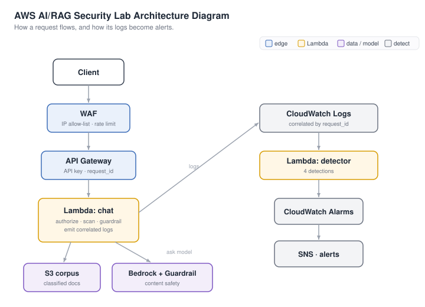

# AI / RAG Security Lab

[](https://github.com/purpleshellsecurity/aws-ai-security-lab/actions/workflows/ci.yml)
[](LICENSE)


> A deployable AWS lab that **reproduces a RAG-assistant breach and the controls that stop it** —
> built with Terraform, mapped to the OWASP LLM Top 10 and MITRE ATLAS, and validated end-to-end
> against a live deployment.



---

## What this demonstrates

| Skill | Demonstrated by |
|---|---|
| **AI/LLM security** | prompt injection, RAG abuse, data exfiltration, system-prompt leakage ([OWASP LLM Top 10](docs/owasp-mapping.md)) |
| **Threat modeling** | every attack tagged to a [MITRE ATLAS](docs/atlas-mapping.md) technique |
| **Detection engineering** | 4 CloudWatch detections → alarms → SNS, over structured logs |
| **Secure AWS architecture** | retrieval-layer authz, least-privilege IAM, KMS, WAF, correlated logging (one `request_id` end to end) |
| **Infrastructure as code** | the whole stack in Terraform; one command up, one down |
| **Validation** | a [test runbook](TESTING.md) that deploys, attacks, and proves each control ([lessons](docs/tuning.md)) |

## How it works

A request flows Client → WAF → API Gateway → chat Lambda, which **enforces access control before any
document is read** and applies **Bedrock's Guardrail** for content safety. Every layer logs under one
`request_id`, and a second **detector Lambda** turns those logs into alarms.

## What it defends against

Each attack maps to a control, a framework, and a replayable scenario (full detail in
[controls-matrix.md](docs/controls-matrix.md)):

| Attack | Control that stops it | OWASP · ATLAS | Scenario |
|---|---|---|---|
| Service account used from an external IP | network check + WAF / resource policy + detection | LLM06 · T0012 | `04_account_compromise` |
| Under-cleared user pulls restricted docs | **authorization at the retrieval layer** | LLM02 · T0057 | `03_data_exfiltration` |
| Prompt injection / "list all documents" | Bedrock Guardrail (prompt-attack + denied topic) | LLM01 · T0051 | `02_prompt_injection` |
| Jailbreak / persona override | Bedrock Guardrail | LLM01 · T0054 | `05_jailbreak` |
| System-prompt extraction | retrieval authz + Guardrail | LLM07 · T0056 | `06_system_prompt_extraction` |
| Poisoned document (hidden instructions) | retrieval-time injection scanner + detection | LLM01 · T0051.001 | `07_indirect_injection` |

---

## Quickstart

**You'll need:**

- **AWS account** with the `aws` CLI configured
- **Terraform ≥ 1.5**
- **Bedrock access** — Anthropic models need a one-time use-case form; `./scripts/preflight.sh` tells you where to click
- Default region **`us-east-1`**

*Usage costs a few cents/day, and everything is torn down by one `destroy`. Note the always-on
baseline: the WAF web ACL, KMS key, and CloudTrail Bedrock data events bill roughly **$10–15/month
even at zero traffic** — destroy the lab when you're not using it.*

### 1. Deploy

```bash
./scripts/preflight.sh            # check AWS creds, Terraform, region, Bedrock access
terraform -chdir=terraform init   # first time only
terraform -chdir=terraform apply  # deploy (~cents/day); review the plan, type "yes"
```

### 2. Run an attack and see it caught

```bash
./demo/replay.py --scenario demo/scenarios/04_account_compromise.json   # fire an attack
./demo/show_detections.sh   # ~30–60s later: what the detector caught
```

### 3. Flip the controls off, then on

The headline demo — the *same* attack succeeds, then is blocked:

```bash
terraform -chdir=terraform apply -var=controls_enabled=false   # OFF — attack succeeds
terraform -chdir=terraform apply -var=controls_enabled=true    # ON  — attack blocked (default)
```

### 4. Run other attacks (optional)

```bash
./demo/replay.py --list   # list all scenarios
./demo/replay.py          # the full incident, end to end
./demo/trace.sh           # fire one request, trace it across every layer
```

Write your own by copying a file in [`demo/scenarios/`](demo/scenarios/README.md).

### 5. Tear down

```bash
terraform -chdir=terraform destroy   # stops the cost
```

> **Shared-account caveat:** the lab manages two per-account/per-region singletons — the API Gateway
> CloudWatch-logging role and the Bedrock model-invocation logging config. In a **dedicated lab
> account** (recommended) this is a non-issue; in a shared account, `destroy` resets both, which
> disables API Gateway access logging and Bedrock invocation logging for everything else in that
> account/region. Note the pre-existing settings before deploying so you can restore them.

---

## Documentation

- **Understand** — [overview](docs/overview.md) · [architecture](docs/architecture.md) · [tutorial](TUTORIAL.md)
- **Operate** — [testing runbook](TESTING.md) · [tuning & lessons](docs/tuning.md) · [attack scenarios](demo/scenarios/README.md)
- **Frameworks** — [controls matrix](docs/controls-matrix.md) · [MITRE ATLAS map](docs/atlas-mapping.md) · [OWASP LLM map](docs/owasp-mapping.md) · [end-to-end logging](docs/end-to-end-logging.md)
- **Project** — [contributing](CONTRIBUTING.md) · [security](SECURITY.md) · [changelog](CHANGELOG.md)

## Repo layout

```
.
├── terraform/      all infrastructure (one .tf file per concern)
├── src/
│   ├── chat/       the assistant Lambda — access control + injection scan + guardrail
│   └── detector/   the detection Lambda — 4 detections
├── corpus/         seed documents (incl. a poisoned one) + classification manifest
├── demo/           replay.py, trace.sh, and scenarios/ (ATLAS-tagged attacks)
├── scripts/        preflight.sh (prerequisite + deploy-status checks)
└── docs/           overview, architecture, controls/ATLAS/OWASP maps, logging, tuning
```

MIT licensed.
