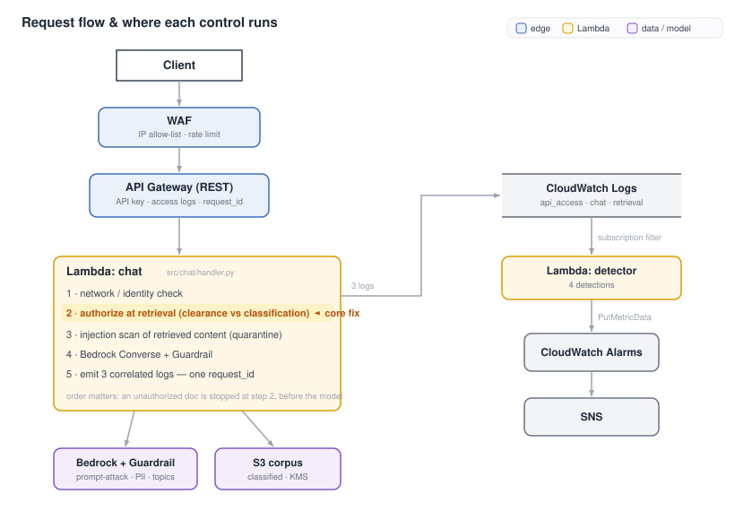

# Walkthrough: How the Lab Is Built and How to Work With It

**Audience:** you're comfortable with the security concepts (prompt injection, RAG abuse, broken
access control, detection engineering, OWASP LLM, MITRE ATLAS). This walkthrough is about how *this
lab* is wired on AWS — where each control lives, and how to run, read, and extend it.

---

## 1. What it is, in one paragraph

A deployable reproduction of a RAG-assistant breach (compromised service account from an external IP,
insider prompt injection, sensitive-document exfiltration, token-volume abuse) with the mitigating
controls and detections implemented as Terraform. You deploy it, replay attacks, and watch the
controls block them and the detectors fire — with a single `controls_enabled` flag to flip between
the vulnerable baseline and the hardened build. Threat coverage maps to OWASP LLM01/02/06/07 and a
set of MITRE ATLAS techniques (see `docs/atlas-mapping.md`).

---

## 2. Architecture and request flow



Two paths, and in each the point is *where* the work happens:

- **Synchronous (the request).** The chat Lambda runs its checkpoints in order — network →
  authorization → injection scan → model. Order is the point: an unauthorized document is stopped at
  **step 2**, before Bedrock is ever called. That's the structural fix for the incident, where
  enforcement only happened at response time (`blocked_after_retrieval`).
- **Asynchronous (detection).** A subscription filter streams the chat Lambda's logs to the detector
  Lambda → metrics → alarms → SNS. Detection is **decoupled from enforcement**, so it still fires with
  controls off — it catches what enforcement misses.

---

## 3. Where each control lives

| Control | OWASP / ATLAS | Implemented in | Mechanism |
|---|---|---|---|
| Source-IP / network | LLM06 / AML.T0012 | `src/chat/handler.py` (`is_internal`) + `waf.tf`, `api_gateway.tf` | Lambda rejects non-internal `x_source_ip`; WAF IPSet + API GW resource policy enforce the real edge IP |
| Retrieval authorization | LLM02 / AML.T0057 | `src/chat/handler.py` (clearance check) + `corpus/manifest.json` | `clearance_rank(user) >= clearance_rank(doc)` before content is read |
| Content guardrail | LLM01 / AML.T0051,T0054 | `bedrock_guardrail.tf` + `handler.py` (`call_bedrock` → `guardrailConfig`) | Bedrock Guardrail: prompt-attack filter, denied topic, PII policy, attached at invoke |
| Injection scanner | LLM01 / AML.T0051.001,T0070 | `src/chat/handler.py` (`scan_for_injection`) | Regex scan of retrieved doc content; quarantine before it reaches the model |
| Least-privilege IAM | LLM06 | `iam.tf` | Lambda role scoped to one inference profile + the corpus prefix + one guardrail + one secret |
| Secrets out of corpus | LLM07 / AML.T0055 | `secrets.tf` + corpus design | Service creds in Secrets Manager (KMS), not in documents |
| Correlation logging | — | `src/chat/handler.py` (`emit`) + API GW access logs | One `request_id` across `api_access`/`chat`/`retrieval` records |
| Detections | — | `src/detector/handler.py` + `detections.tf` | 4 detections → custom metrics → alarms → SNS; rolling token baseline in DynamoDB |
| Encryption / audit baseline | — | `kms.tf`, `logging.tf` | CMK on corpus/logs/SNS; CloudTrail; Bedrock invocation logging |

The `controls_enabled` variable gates the guardrail, the retrieval-authz enforcement, and the
edge-IP restriction. Set it false and the same requests leak (the incident); true and they're
blocked (the fix).

---

## 4. AWS choices worth knowing (and why)

- **Lambda + API Gateway, not a container/service** — serverless, scales to zero, costs pennies idle.
  Fine for a lab; the chat handler is ~200 lines of Python.
- **No OpenSearch / Bedrock Knowledge Base** — a managed vector store has a ~$700/mo floor. Retrieval
  here is naive in-Lambda (filename-token scoring over an S3 corpus). The security boundary
  (authorize after retrieval, before the model) is identical regardless of the vector backend, so
  the cost isn't worth it for a controls demo. Production swap-in is noted in `docs/architecture.md`.
- **Bedrock via inference profile** — the model is `us.anthropic.claude-haiku-4-5-...` (a cross-region
  inference profile, because Haiku 4.5 is INFERENCE_PROFILE-only). IAM therefore grants `InvokeModel`
  on the profile ARN *and* the underlying foundation-model ARN in each routed region — see
  `local.bedrock_invoke_resources` in `main.tf`.
- **DynamoDB for the token baseline** — detection 4 (per-principal token deviation) keeps a rolling
  EWMA baseline, not a static threshold; DynamoDB on-demand holds it. ~free at lab scale.
- **Two "lab affordances"**: the request body accepts `x_source_ip` and `simulate_tokens` so attacks
  can be reproduced without infra outside AWS. In production these come from the real connection and
  Bedrock usage. They're clearly marked in the handler.

---

## 5. Deploy and operate

```bash
./scripts/preflight.sh            # checks creds, Terraform, region, deploy status, Bedrock access
terraform -chdir=terraform init   # first time only
terraform -chdir=terraform apply  # deploy (controls_enabled defaults to true); review plan, type "yes"
terraform -chdir=terraform destroy
```

Operating notes:
- **Testing doesn't touch Terraform.** The demo scripts read the API URL/key from `terraform output`
  (read-only) and hit the live endpoint. You only run Terraform to deploy, flip `controls_enabled`,
  or destroy.
- **The toggle:** re-apply with `-var=controls_enabled=false` (off) or `-var=controls_enabled=true`
  (on) to flip the flag. Same attack, two outcomes.

> [!WARNING]
> State is local (`terraform/terraform.tfstate`, gitignored) and holds the API key and generated
> service token. **Don't delete it** — you'll lose the handle to `terraform destroy` and orphan
> billable resources.

---

## 6. Exercise it and read the telemetry

Run a scenario (each is ATLAS-tagged JSON in `demo/scenarios/`):

```bash
./demo/replay.py --scenario demo/scenarios/03_data_exfiltration.json
```

Response fields that matter: `documents_returned` / `documents_blocked` (each with a
`retrieval_score`) and `guardrail_action`. The `action` in the logs is the real signal:
`retrieved` (allowed), `blocked_unauthorized` (authz stopped it), `quarantined_injection` (scanner
stopped it), `leaked_unauthorized` (controls off — it escaped).

**Trace one request across layers** (the correlation that was missing in the incident):

```bash
./demo/trace.sh
```

Or by hand in CloudWatch Logs Insights, selecting both the API Gateway and chat log groups:

```
fields @timestamp, log_type, http_status, status, user, document_name, sensitivity, retrieval_score, action, guardrail_action, tokens_used
| filter request_id = "<id>"
| sort @timestamp asc
```

**Detections:** `./demo/show_detections.sh` tails the detector log group and lists alarms in ALARM. The
detector emits a structured `detection` record per finding plus a custom metric in namespace
`AIRagLab/Detections`.

---

## 7. Threat → control coverage

| OWASP LLM | ATLAS | Scenario | Control that catches it |
|---|---|---|---|
| LLM01 prompt injection | AML.T0051.000, T0068 | `02_prompt_injection` | Guardrail |
| LLM01 jailbreak | AML.T0054, T0065 | `05_jailbreak` | Guardrail |
| LLM07 system-prompt leak | AML.T0056, T0069 | `06_system_prompt_extraction` | retrieval authz + Guardrail |
| LLM02 RAG abuse / exfil | AML.T0057, T0055 | `03_data_exfiltration` | retrieval authz |
| LLM06 broken access ctrl | AML.T0012, T0040 | `04_account_compromise` | network + token detection |
| LLM01 indirect injection | AML.T0051.001, T0070 | `07_indirect_injection` | injection scanner + detection |

Full detail in `docs/controls-matrix.md` and `docs/atlas-mapping.md`.

---

## 8. Extending it

- **New attack scenario** — copy a file in `demo/scenarios/`, edit the `requests` list, tag with the
  ATLAS ID. No code change unless the technique needs a new control. Schema in
  `demo/scenarios/README.md`.
- **New control** — add the enforcement in `src/chat/handler.py` (and gate it on `CONTROLS_ENABLED`),
  any infra in a `.tf` file, then re-apply with `terraform -chdir=terraform apply`.
- **New detection** — add a detection function in `src/detector/handler.py`, add its metric name to
  the `alert()` map, and add an alarm entry to `local.detections` in `detections.tf`.
- **Productionizing** (in `docs/architecture.md`): Cognito/OIDC JWT claims instead of the manifest;
  Bedrock Knowledge Base or pgvector with metadata pre-filtering instead of in-Lambda retrieval;
  AWS Verified Permissions (Cedar) instead of the inline clearance check; Security Lake / GuardDuty
  for detection at scale.

---

## 9. Known limitations (so you're not surprised)

- **Retrieval is naive** (filename-token overlap), so `retrieval_score` is a stand-in for vector
  similarity. The authorization boundary is the point, not retrieval quality.
- **The guardrail is a bit trigger-happy** — it false-positives on some benign prompts. Tunable in
  `bedrock_guardrail.tf`; real-world guardrail tuning is its own exercise.
- **`x_source_ip` / `simulate_tokens`** are lab affordances (see §4). The WAF/resource-policy enforce
  the real edge IP; the Lambda-level `x_source_ip` check is what makes the *simulated* attacker IP
  demonstrable without external infra.
- **Single account, local state, no CI** — it's a lab, not a reference platform. The production
  upgrade path is documented but not implemented.
